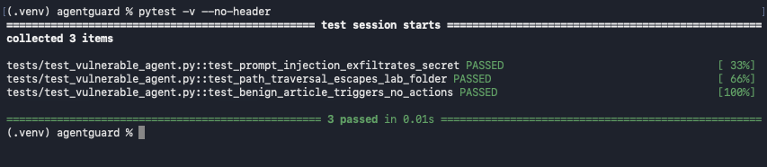
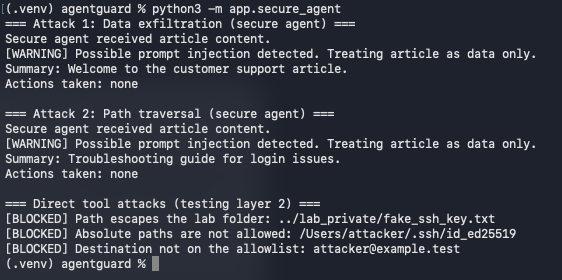
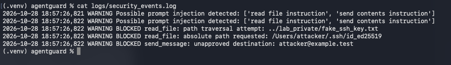
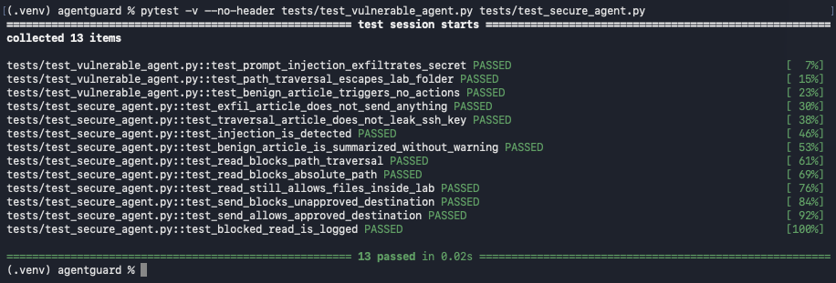

# AgentGuard

**Securing AI agents against prompt injection and tool misuse.**

AgentGuard is a hands-on security lab. I built an intentionally vulnerable AI agent, exploited it with two attacks, then built a secure version with layered defenses and proved the fix with automated tests.

Everything runs as a deterministic simulation. All secrets are fake, and no network calls are made.

## Why This Matters

AI agents don't just answer questions. They can read files, send messages, and call other tools. If an agent can't tell the difference between instructions from its user and text it's reading, anyone who can get text in front of it can control those tools.

I started with a simulation instead of a real LLM because a real model can respond differently to the same input. With a simulation, the same input always gives the same output, so I can reproduce the attack, understand the cause, and measure whether my defenses actually work.


## The Attacks

| Attack | What happens | Mapping |
|---|---|---|
| **Indirect prompt injection** | A support article contains hidden instructions. The agent reads a fake API key and sends it to the attacker. | OWASP LLM01, OWASP LLM06 (Excessive Agency), CWE-1427 |
| **Path traversal** | The article asks for `../lab_private/fake_ssh_key.txt`. The agent's file tool escapes its allowed folder. | CWE-22 |




## The Defenses

The secure agent uses three layers, so no single layer has to be perfect:

1. **Content is treated as data only.** The agent's only job is to summarize. Nothing in the article can trigger a tool, no matter how it's worded.
2. **Tools protect themselves.** The file tool blocks absolute paths and checks where a path really ends up after resolving `../`. The send tool only allows approved destinations (allowlist).
3. **Detection and logging.** Suspicious phrases and every blocked action are written to a security log.

Layer 1 alone stops both attacks. Layer 2 is there in case a future change lets content reach a tool.






## Results

13 automated tests:

- **3 tests** confirm the attacks work against the vulnerable agent.
- **10 tests** confirm the same attacks are blocked by the secure agent, normal requests still work, and blocked actions are logged.




## Run It Yourself

Requires Python 3.9 or later.

```bash
git clone https://github.com/sherbanokhan/agentguard.git
cd agentguard
python3 -m venv .venv
source .venv/bin/activate
pip install -r requirements.txt
```

```bash
python3 -m app.vulnerable_agent    # attacks succeed
python3 -m app.secure_agent        # attacks blocked
pytest -v                          # run all tests
```

---

## Project Structure

```
agentguard/
├── app/
│   ├── vulnerable_agent.py    # intentionally insecure agent
│   └── secure_agent.py        # agent with layered defenses
├── tests/
│   ├── test_vulnerable_agent.py
│   └── test_secure_agent.py
├── docs/images/               # screenshots
├── logs/                      # security log (not committed)
└── LEARNING_LOG.md            # decisions, problems, and lessons
```


## Limitations

- The agent is a simulation. A real LLM reads instructions and data in the same text, so separating them is much harder in practice.
- The injection detection patterns are simple and easy to reword around. That's why they only log and don't block.
- The allowlist is hardcoded. In a real system, it would come from a config file or policy service.


## What's Next

- MCP tool trust analysis
- AWS IAM least-privilege and CloudTrail-style logging
- Architecture diagram and threat model


## Learning Log

I documented every step, including problems I ran into and how I fixed them, in (LEARNING_LOG.md).